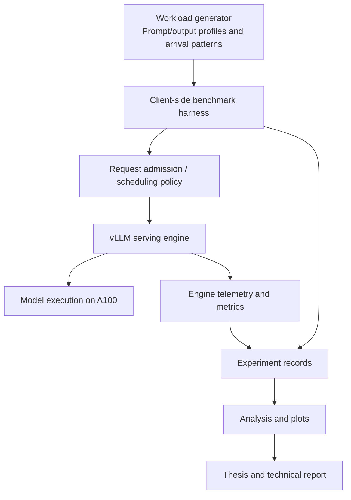

# LLM Serving Systems — Undergraduate Thesis Plan

**Working title:** *Performance Profiling and SLO-Aware Scheduling for Large Language Model Serving under Heterogeneous Workloads*

> **Status:** Planning · **Project window:** October 2026 – June 2027  
> **Focus:** AI systems / inference infrastructure · **Current contents:** Documentation only

This repository documents the design and execution plan for an undergraduate thesis in **LLM serving systems**. The project aims to move beyond deploying a pretrained model: it will study real serving bottlenecks, implement one carefully scoped systems improvement, and evaluate its benefits and limitations through reproducible experiments.

**No implementation, benchmark results, or performance claims exist yet.** Research questions, model choices, and implementation details will be refined after the initial profiling phase and academic-supervisor approval.

## At a glance

| Item | Plan |
| --- | --- |
| **Core goal** | Understand and improve serving performance under mixed prompt lengths, generation lengths, and request-arrival patterns. |
| **Primary framework** | [vLLM](https://github.com/vllm-project/vllm), initially focusing on its V1 engine and scheduler. |
| **Technical focus** | Continuous batching, prefill/decode behavior, queueing, KV-cache pressure, request scheduling, and SLO-aware evaluation. |
| **Local development** | Arch Linux workstation with NVIDIA RTX 4060; use for development, code reading, smoke tests, and small-model runs. |
| **Formal experiments** | Allocated NVIDIA A100 resources with a total budget of **500 GPU-hours** (subject to cluster accounting and availability). |
| **Final outputs** | A reproducible benchmark suite, an implemented and tested improvement, experimental analysis, a thesis, and a portfolio-ready technical report. |
| **Target completion** | Undergraduate thesis submission / defense in June 2027, subject to the university's official deadlines. |

### Project principles

1. **Measure before optimizing.** Select an intervention only after observing a repeatable problem.
2. **Learn by building.** Tie OS, distributed systems, GPU architecture, and ML systems concepts to experiments and code.
3. **Compare fairly.** Report baseline tuning and negative results, not only the strongest-looking outcome.
4. **Keep the scope realistic.** A rigorous single-GPU study is better than an unfinished distributed platform.
5. **Preserve reproducibility.** Pin code revisions, save workload definitions, and record hardware and configuration.

---

## Contents

- [1. Motivation and problem statement](#1-motivation-and-problem-statement)
- [2. Objectives, research questions, and hypotheses](#2-objectives-research-questions-and-hypotheses)
- [3. Scope and expected contribution](#3-scope-and-expected-contribution)
- [4. Proposed architecture](#4-proposed-architecture)
- [5. Technical learning plan](#5-technical-learning-plan)
- [6. Methodology and experiment design](#6-methodology-and-experiment-design)
- [7. Milestones and timeline](#7-milestones-and-timeline)
- [8. Hardware and 500 GPU-hour budget](#8-hardware-and-500-gpu-hour-budget)
- [9. Deliverables and acceptance criteria](#9-deliverables-and-acceptance-criteria)
- [10. Risks and fallback plans](#10-risks-and-fallback-plans)
- [11. Immediate action checklist](#11-immediate-action-checklist)
- [12. References and learning resources](#12-references-and-learning-resources)

---

## 1. Motivation and problem statement

High-throughput LLM serving is a systems problem, not merely a model-inference problem. Requests differ in prompt size, expected output length, arrival time, and latency requirements. At the same time, a serving engine must share GPU compute, memory, and KV-cache capacity among concurrent requests.

Mechanisms such as **continuous batching**, **chunked prefill**, and **paged KV-cache management** help, but scheduling decisions still involve trade-offs:

- High aggregate token throughput does not necessarily mean good user-perceived latency.
- Long or compute-intensive requests can interact unfavorably with latency-sensitive requests.
- Admitting too much work can increase queueing, memory pressure, or preemption.
- An optimization that helps one workload may regress another workload or fairness.

**Research problem:** Under a fixed single-GPU resource budget, can a measured and appropriately scoped scheduling or admission-control mechanism improve **SLO-attaining throughput** and/or **tail latency** for heterogeneous workloads without unacceptable regressions in total throughput, fairness, or stability?

This is an **open empirical question**, not a claim that current vLLM scheduling is inefficient.

### Why this project

The work connects a background in empirical software engineering—building data-processing pipelines, designing evaluations, interpreting results, and communicating findings—with the skills required for AI infrastructure engineering: systems programming, performance profiling, resource management, and scientific benchmarking.

The primary purpose is to learn and demonstrate rigorous systems engineering. Publication-level novelty is a possible bonus, **not a prerequisite for a successful undergraduate thesis**.

## 2. Objectives, research questions, and hypotheses

### Objectives

- **O1 — Understand the engine.** Trace request lifecycle, prefill/decode execution, batching, waiting/running queues, and memory-related scheduling decisions in a pinned vLLM revision.
- **O2 — Build reproducible benchmarks.** Generate and characterize mixed workloads; measure throughput, latency distributions, and relevant server-side state.
- **O3 — Identify a bottleneck.** Show at least one repeatable behavior with a plausible and testable explanation.
- **O4 — Implement one intervention.** Design a focused algorithm, policy, or control mechanism with unit tests and a clearly documented integration point.
- **O5 — Evaluate trade-offs.** Compare the intervention with fair, appropriately tuned baselines across multiple scenarios, including unfavorable ones.
- **O6 — Produce an academic and engineering artifact.** Explain design decisions, implementation details, results, limitations, and replication steps.

### Candidate research questions

| ID | Question | Evidence required |
| --- | --- | --- |
| RQ1 | How do workload heterogeneity and arrival patterns affect TTFT, TPOT, end-to-end latency, throughput, and KV-cache utilization? | Controlled profiling and workload comparisons. |
| RQ2 | Under which load conditions do queueing, prefill/decode interference, or KV-cache pressure become dominant? | Time-aligned client/server measurements and controlled variations. |
| RQ3 | Can a focused SLO-aware scheduling/admission policy improve goodput or tail latency against reasonable baselines? | Repeated A/B experiments with predeclared SLOs. |
| RQ4 | What throughput, fairness, or implementation-complexity costs accompany the improvement? | Explicit regression, starvation, and overhead measurements. |

### Tentative hypotheses — to test, not assume

- **H1:** Heterogeneous workloads can create worse tail latency than comparable homogeneous workloads under some load levels.
- **H2:** A workload-aware control mechanism may improve SLO goodput at moderate/high utilization **for specific workload mixes**.
- **H3:** Any performance benefit will involve trade-offs and may disappear at low load or when the baseline is carefully tuned.

The thesis is still valid if H2 is unsupported, provided the study is rigorous and the engineering and analysis are substantive.

## 3. Scope and expected contribution

### Minimum viable thesis (must-have)

1. Deploy a reproducible, single-GPU vLLM serving stack.
2. Build a benchmark harness with multiple workload profiles and controlled arrival patterns.
3. Capture client-side latency and server-side engine metrics.
4. Investigate and document at least one repeatable performance bottleneck.
5. Implement one measured improvement—**preferably a scoped change inside or closely coupled to the scheduler**—with unit/integration tests.
6. Compare against stock vLLM and at least one simpler, tuned baseline.
7. Produce a rigorous write-up, including negative results and limitations.

### Preferred technical depth

The first choice is a **small, inspectable scheduler-level change** or policy experiment informed by the profiling phase. Possible directions include:

- SLO-aware admission or queue prioritization in mixed workloads.
- Prefill scheduling and token-budget policy under varying queue pressure.
- KV-cache-pressure-aware admission to reduce harmful overcommitment.
- A deliberately narrow fairness/latency policy with bounded starvation risk.

**Do not commit to one solution before profiling.** vLLM already has scheduling policies, token limits, cache protections, and related controls; first inspect the *pinned revision* and prove how the proposed mechanism differs from existing settings or policies.

### Fallback contribution

If scheduler internals prove too unstable or costly to modify within the thesis deadline, implement a carefully evaluated **external admission-control policy** coupled with a rigorous workload and observability harness. The fallback is acceptable only if it demonstrates a nontrivial policy and evaluation—not merely a proxy forwarding requests.

### Out of scope

- Training a foundation model or creating a new model architecture.
- Reimplementing vLLM, PagedAttention, or a complete inference engine.
- Writing production-ready CUDA kernels from scratch.
- Building a multi-node GPU cluster or full Kubernetes ML platform.
- Claiming general-purpose superiority across all models, hardware, or workload types.

**Stretch goals, only after the core thesis works:** validate on a second model or hardware configuration, contribute a change upstream, or perform a limited two-GPU/disaggregated-serving study *if resources and cluster policies permit*.

## 4. Proposed architecture



**Architecture note:** The policy may live inside vLLM or at the serving boundary, depending on the experimentally justified approach. The block diagram is conceptual, not a claim that an implemented subsystem already exists.

### Planned repository structure *after implementation begins*

```text
.
├── README.md                     # Current project plan
├── src/                          # Policy implementation (later)
├── benchmarks/                   # Workload generation and runners (later)
├── configs/                      # Pinned experiment settings (later)
├── tests/                        # Unit and integration tests (later)
├── analysis/                     # Scripts and reproducible plots (later)
└── docs/                         # Thesis notes and design decisions (later)
```

The initial repository intentionally contains **only this README**. Do not create empty folders or placeholder source files until they are needed.

## 5. Technical learning plan

Use **project-driven learning**: study a concept when an experiment or implementation makes its need concrete. The key outcome is the ability to reason about and modify a real serving system.

| Topic | Concepts to understand | Practical proof of understanding |
| --- | --- | --- |
| LLM inference | Transformer inference, prefill vs. decode, autoregressive generation | Explain the bottlenecks of a measured prefill-heavy and decode-heavy workload. |
| GPU systems | GPU compute vs. memory-bandwidth limits, memory allocation, profiling | Interpret utilization and latency behavior without assuming every slowdown is a GPU bottleneck. |
| Serving systems | Continuous batching, chunked prefill, KV cache, scheduler state | Trace the lifecycle of a request through vLLM source code. |
| Operating systems | Concurrency, queues, resource allocation, scheduling, memory pressure | Explain how admission, queuing, and resource scarcity affect latency. |
| Queueing and SLOs | Arrival rates, saturation, tail latency, throughput, goodput | Design a load sweep and explain the knee of the latency–throughput curve. |
| Measurement | Warm-up, cache effects, confounders, repeated trials, uncertainty | Reproduce a baseline and provide variability/error estimates. |
| Engineering | Code review, tests, version pinning, logs, failure handling | Deliver a small, reviewable, tested patch and a repeatable runbook. |

Suggested learning pattern: **read the specific concept → inspect the relevant source → run a focused experiment → document the result**. The weekly cadence is flexible; the experiment artifacts, not the number of video lectures watched, determine progress.

## 6. Methodology and experiment design

### 6.1 Phase A — Establish a baseline

1. Inspect the cluster's A100 variant, accessible VRAM, GPU-sharing/MIG policy, wall-time limits, scheduling system, container support, and billing rules.
2. Select one open-weight model that reliably fits the allocated accelerator with the intended context length, precision, and concurrency. A roughly 3B–8B candidate is a starting range, **not a commitment**.
3. Pin the model revision, tokenizer, CUDA environment, Python dependencies, and vLLM Git commit or release.
4. Confirm that the serving process and benchmark runner can run within the cluster's approved job model.
5. Verify correct responses, streaming behavior, health checks, and metrics collection.
6. Perform short pilot runs to determine sustainable request rates and appropriate SLO thresholds.

**Avoid mixing client/server hardware effects:** The RTX 4060 is for development. Formal A/B comparisons should use the **same A100 allocation** with identical model and software settings.

### 6.2 Phase B — Workload matrix

The initial matrix is illustrative; exact lengths and rates will be selected after pilot runs.

| Workload profile | Example input | Example generated output | What it stresses |
| --- | ---: | ---: | --- |
| Short interactive | 128 tokens | 128 tokens | Request overhead and TTFT sensitivity. |
| Long prompt | 2,048 tokens | 128 tokens | Prefill demand and potential queue interference. |
| Decode-heavy | 256 tokens | 1,024 tokens | Repeated decode steps and ongoing KV-cache occupancy. |
| Mixed | Weighted combination of the above | Mixed | Interference, fairness, and tail behavior. |

Vary the **arrival process** separately:

- Low, moderate, near-saturation, and overloaded *request rates*.
- A controlled Poisson-like arrival process and at least one bursty pattern.
- Fixed-concurrency runs as a separate experiment (do not equate concurrency sweeps with open-loop arrivals).
- Optional cold-/warm-prefix-cache conditions, explicitly labeled and controlled.

Do not automatically treat synthetic traffic as representative of a production service. If a public real-world trace can be used legally and reproducibly, it may complement—not replace—the controlled experiments.

### 6.3 Phase C — Measurements

| Metric | Interpretation | Notes |
| --- | --- | --- |
| TTFT | Time from request issuance to the first streamed response token | Include client-observed network/service delay; report measurement origin. |
| TPOT | Per-request average generation time per output token after the first | Distinct from raw inter-token latency (ITL) in some decoding modes. |
| E2E latency | Request start to completion | Report mean, median, P95, P99 where sample count permits. |
| Output token throughput | Generated tokens per second | Separate from requests per second. |
| Request throughput | Completed requests per second | State completion/error inclusion rules. |
| SLO goodput | Requests per second satisfying predeclared latency objectives | Define SLO thresholds **before** final comparisons. |
| Queue pressure | Waiting/running requests and queue time | Time-align with latency spikes. |
| KV-cache occupancy | Fraction of assigned KV-cache capacity in use | Track pressure and potential preemption; do not confuse with total GPU memory usage. |
| Failure/fairness | Timeouts, errors, starvation or per-class slowdown | A policy must not silently improve one group by abandoning another. |

Relevant telemetry is available through vLLM's Prometheus-compatible `/metrics` endpoint; metric names and semantics should be verified for the pinned version.

### 6.4 Phase D — Baselines and intervention

At minimum compare:

- **B0:** Stock vLLM with documented default settings.
- **B1:** Stock vLLM with a reasonable, disclosed parameter tuning effort.
- **B2:** A simple policy or fixed threshold (if technically comparable).
- **P:** The proposed policy/change.

For each candidate policy, document:

- The motivating bottleneck, its assumptions, and exactly where decisions are made.
- The inputs used (for example, queue depth, waiting time, or KV-cache pressure).
- The invariant/safety checks, fallback behavior, and starvation prevention.
- The implementation overhead and any compatibility changes.
- The ablation that removes the new component or disables its adaptive behavior.

**The policy must beat a fair baseline, not just a weak default.** If simpler tuning achieves the same result, report that finding prominently.

### 6.5 Phase E — Evaluation quality and reproducibility

- Reserve a warm-up interval and keep its observations separate from measured runs.
- Repeat key experiments (aim for at least 3 independent repetitions; increase if results are noisy).
- Record run order and random seeds; alternate or randomize policy order when possible.
- Record model, tokenization, precision, context limits, GPU variant/VRAM, drivers, CUDA, dependency versions, and vLLM revision.
- Keep prompt and output-length distributions, arrival patterns, and request counts comparable across policies.
- Check whether prefix-cache reuse, compilation, thermal variation, or other shared-node users may have influenced results.
- Use uncertainty estimates (such as confidence intervals) when feasible; avoid overinterpreting tiny differences.
- Report both wins and regressions, including low-load and overloaded regimes.
- Save raw measurements where licensing/privacy permits; never publish tokens, credentials, internal hostnames, or private cluster configuration.
- Consider run-level statistics as the independent unit when assessing variability; avoid treating millions of correlated token observations as independent trials.

**Decision gate:** Do not claim an improvement until it reproduces under matched conditions and its trade-offs are understood.

## 7. Milestones and timeline

These are planning targets based on an October 2026 start and an expected June 2027 graduation. Adjust them to the university's approved thesis calendar.

| Period | Primary activities | Concrete exit criterion |
| --- | --- | --- |
| **Oct–Nov 2026** | Thesis-advisor alignment; read vLLM/PagedAttention literature; local deployment; inspect scheduler; cluster onboarding. | Approved scope, environment notes, a small model running locally, and a documented code-path walkthrough. |
| **Dec 2026–Jan 2027** | A100 deployment; benchmark harness; initial workload matrix; instrumentation; bottleneck exploration. | Reproducible baseline report with raw metrics and a justified candidate bottleneck. |
| **Feb–Mar 2027** | Select a narrowly scoped intervention; implement; add tests; run A/B pilots; revise design. | Working implementation, clear B0/B1 comparisons, and an initial evidence-backed result (positive or negative). |
| **Apr–May 2027** | Full study, ablations, repetitions, stress/fairness checks, thesis writing, repository cleanup. | Final experiment package, figures, limitations section, and reviewable thesis draft. |
| **Jun 2027** | Finish the written thesis, reproduce the final results, prepare slides and defense. | Thesis submission and a portfolio-ready technical walkthrough. |

### Short-term planning checkpoints

- **By late November:** Decide whether the project is feasible with the actual A100 allocation and institute rules.
- **By January:** Be able to demonstrate a convincing baseline, even if the optimization direction is undecided.
- **By March:** Freeze the intervention scope. Do not keep changing the main research question before the defense.
- **By May:** Stop adding ambitious features and prioritize reproducibility, interpretation, and writing.

A separate postgraduate application decision is expected around **January–February 2027**. It should not interrupt the project: the baseline results can serve as a technical portfolio regardless of the education path chosen.

## 8. Hardware and 500 GPU-hour budget

### Device roles

| Resource | Intended use | Constraints to verify |
| --- | --- | --- |
| **Local NVIDIA RTX 4060, Arch Linux** | Development, source-level debugging, unit tests, small-model smoke tests, plotting, experiment scripts. | Available VRAM, CUDA/PyTorch compatibility, power and memory constraints. |
| **Cluster NVIDIA A100, 500 free GPU-hours** | Controlled, repeatable serving benchmarks; cache and saturation tests; validated A/B comparisons. | A100 40/80 GB or MIG slice, shared-vs-exclusive use, maximum job time, queue delays, account charging. |

The **500 GPU-hour quota** is a cumulative allocation; it does not guarantee uninterrupted use of a full A100. If two GPUs run for one hour, charging may consume two GPU-hours, subject to the platform's rules.

### Provisional budget

| Purpose | A100 GPU-hours | Rationale |
| --- | ---: | --- |
| Environment validation / smoke tests | 20 | Confirm the complete run pipeline at small scale. |
| Formal baseline measurements | 70 | Characterize the workload matrix and identify bottlenecks. |
| Improvement experiments | 180 | Develop and validate the intervention. |
| Repetitions / ablations | 90 | Check stability, regressions, and key design choices. |
| **Reserve / contingency** | **140** | Protect against failed jobs, reruns, and late discoveries. |
| **Total** | **500** | Do not spend the reserve without a clear reason. |

**Budget controls:**

- Debug scripts and validate inputs locally before launching A100 jobs.
- Run a cheap smoke test before each batch of long benchmarks.
- Stop on failed health checks, missing metrics, or obviously invalid configurations.
- Automatically save logs/results before the cluster terminates a job.
- Record estimated and actual GPU-hours per experiment; review budget weekly.
- Prefer parameter sweeps that answer a specific question over exhaustive grid searches.

## 9. Deliverables and acceptance criteria

### Expected deliverables

1. **Reproducible serving setup:** exact dependencies, model revision, configuration, and cluster-safe launch instructions (once implementation exists).
2. **Benchmark suite:** deterministic workload definitions, arrival generators, client measurements, and data validation.
3. **Profiling report:** a characterization of at least one meaningful bottleneck with supporting plots and an explanation.
4. **Engine-level or control-level change:** a scoped implementation with tests, an architectural explanation, and a clear baseline comparison.
5. **Evaluation package:** per-workload results, repetitions, SLO goodput, latency percentiles, throughput, and explicit regressions.
6. **Thesis:** motivation, related work, problem formulation, design, implementation, methodology, findings, threats to validity, and future work.
7. **Technical portfolio summary:** a concise explanation of what was built, why it mattered, what the data showed, and what remained unsolved.

### Definition of done

- [ ] The academic supervisor has approved the topic and scope.
- [ ] The serving stack can be reproduced from documented versions/configuration.
- [ ] At least three distinct workload profiles and multiple offered-load levels are measured.
- [ ] TTFT, TPOT, latency percentiles, throughput, and SLO goodput are correctly defined and reported.
- [ ] A bottleneck is identified through evidence, not intuition alone.
- [ ] A nontrivial policy/change is implemented and tested.
- [ ] Stock and tuned baseline comparisons are fair and repeatable.
- [ ] The improvement's overhead, trade-offs, and negative cases are discussed.
- [ ] Raw results and plotting scripts support the figures.
- [ ] The thesis and demonstration are complete by the official deadline.

**Success is not defined by achieving an arbitrary percentage speedup.** Rigorous negative findings and a sound implementation can be valuable thesis outcomes.

## 10. Risks and fallback plans

| Risk | Impact | Mitigation / fallback |
| --- | --- | --- |
| **No truly new bottleneck** | Chosen optimization duplicates existing vLLM features. | Compare with recent work and tuned built-in policies; pivot to rigorous profiling or a distinct control problem. |
| **Unstable scheduler interface** | Upstream changes break a custom scheduling class. | Pin a tested vLLM commit, isolate modifications, maintain minimal patches; use external admission control if needed. |
| **Restricted supercomputing environment** | Long-lived HTTP serving or containers may be prohibited. | Ask administrators early; implement a scheduler-job harness that starts the service, benchmarks locally inside the job, saves results, and exits. |
| **Insufficient GPU memory** | Proposed context lengths and concurrency do not fit. | Choose a smaller model, shorten contexts, and narrow research scope without compromising comparability. |
| **Noisy performance results** | Small reported improvements are not trustworthy. | Repeat experiments, capture utilization and contention, report uncertainty, and avoid misleading claims. |
| **Quota exhaustion** | Validation incomplete. | Maintain the 140-hour reserve and enforce staged experiment approvals. |
| **Research scope expansion** | Project becomes too large to finish. | Maintain a single-GPU minimum viable thesis; defer multi-GPU and kernel work. |
| **Academic schedule mismatch** | Late topic changes conflict with submission rules. | Agree on topic and deliverables with the supervisor before implementation deepens. |

## 11. Immediate action checklist

### Step 0 — Administrative feasibility

- [ ] Discuss this working topic with the undergraduate thesis supervisor.
- [ ] Confirm expectations: engineering thesis vs. research thesis, proposal date, report format, presentation criteria, and submission deadlines.
- [ ] Check whether modified open-source frameworks and measured benchmarks are acceptable core thesis contributions.

### Step 1 — Environment inventory

- [ ] Record local RTX 4060 VRAM and usable CUDA stack.
- [ ] Confirm whether the A100 allocation is 40 GB, 80 GB, or a partition.
- [ ] Read cluster rules: job scheduler, wall-time, external network access, containers, data storage, and GPU-hour billing.
- [ ] Establish version-controlled environment notes without committing credentials or private machine details.

### Step 2 — Technical first milestone

- [ ] Read the PagedAttention/vLLM paper and the current vLLM scheduler/config documentation.
- [ ] Run a small model locally and inspect the waiting/running request lifecycle.
- [ ] Create a minimal request-load script and collect TTFT/E2E latency.
- [ ] Execute a **short** A100 benchmark using an official or validated benchmark runner.
- [ ] Write a one-page findings memo: *What did I measure? What surprised me? What should I test next?*

### Step 3 — Decide the research intervention

- [ ] Choose one bottleneck supported by measurements.
- [ ] Define B0/B1 baselines and predeclare the main objective metric/SLOs.
- [ ] Review related work and existing vLLM options so the intervention is not a trivial reimplementation.
- [ ] Draft a design memo with measurable acceptance criteria and a rollback plan.

## 12. References and learning resources

The links below are starting points, not an exhaustive literature review. Verify version-specific API behavior against the **exact commit used for the experiments**.

### Framework and official tooling

1. [vLLM — Source repository](https://github.com/vllm-project/vllm)
2. [vLLM benchmark CLI and methodology](https://docs.vllm.ai/en/latest/benchmarking/cli/)
3. [vLLM `bench serve` command reference](https://docs.vllm.ai/en/latest/cli/bench/serve/)
4. [vLLM metrics and observability](https://docs.vllm.ai/en/latest/design/metrics/)
5. [vLLM scheduler configuration reference](https://docs.vllm.ai/en/latest/api/vllm/config/scheduler/)
6. [vLLM scheduler source](https://github.com/vllm-project/vllm/tree/main/vllm/v1/core/sched)

### Research reading

7. [Kwon et al., *Efficient Memory Management for Large Language Model Serving with PagedAttention*, SOSP 2023](https://arxiv.org/abs/2309.06180)
8. [Zhong et al., *DistServe: Disaggregating Prefill and Decoding for Goodput-optimized Large Language Model Serving*](https://arxiv.org/abs/2401.09670)
9. [Sarathi-Serve: Taming Throughput-Latency Tradeoff in LLM Inference with Sarathi-Serve](https://arxiv.org/abs/2403.02310)

### Practical reading order

1. PagedAttention: *why* KV-cache management matters.
2. vLLM architecture and scheduler: *where* decisions are made.
3. vLLM benchmarking and metrics: *how* to measure correctly.
4. DistServe and Sarathi-Serve: *which* latency–throughput trade-offs prior work has studied.
5. Recent scheduler studies: *what remains distinct and worth testing* after baseline profiling.

---

## Project status log

| Date | Status | Note |
| --- | --- | --- |
| 2026-10-15 | **Planning** | Initial research plan drafted. No code, experiments, or results have been committed. |

**Next update:** Confirm thesis-supervisor approval and A100 cluster constraints, then freeze the first benchmark configuration. The title and research questions are intentionally provisional until the profiling evidence is available.
